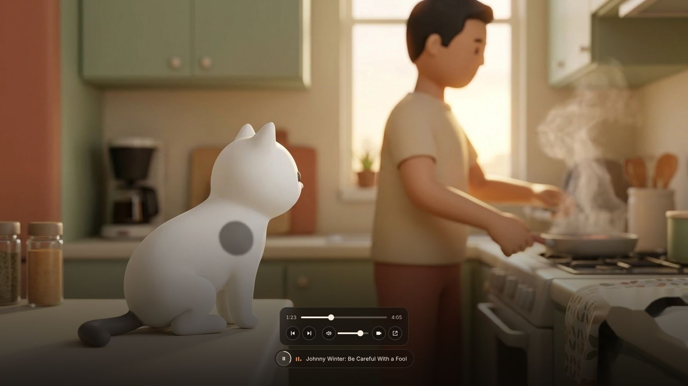
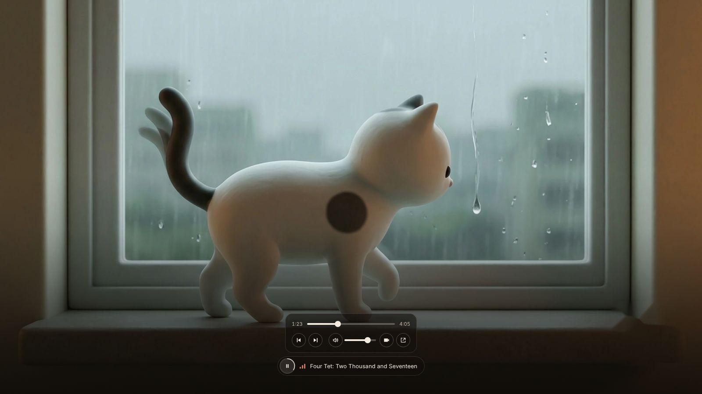
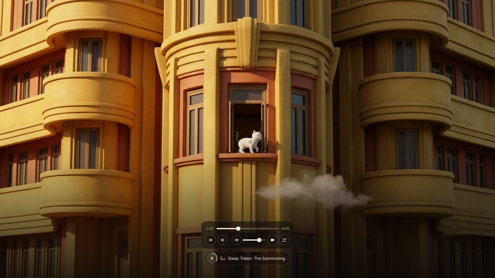
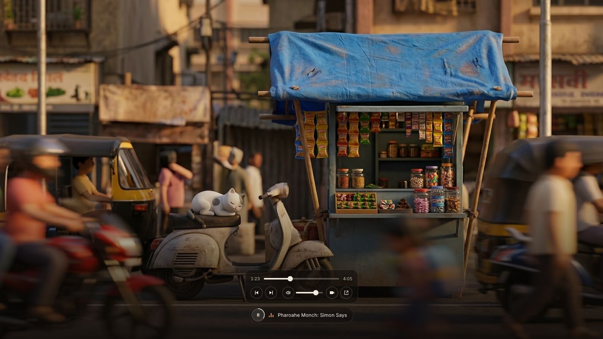
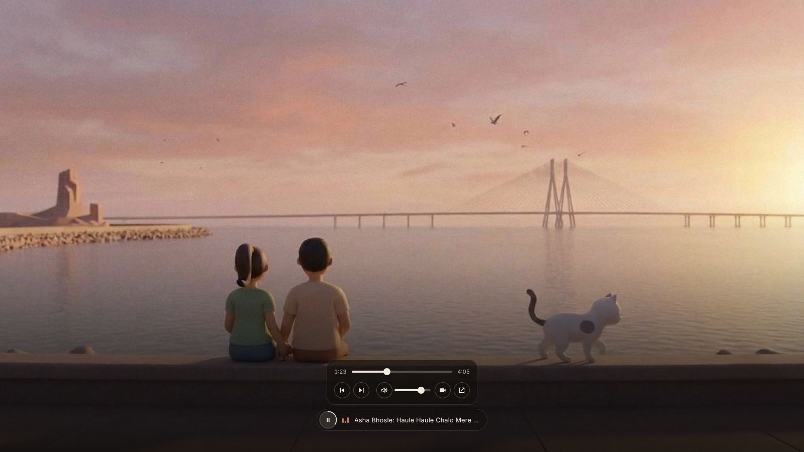
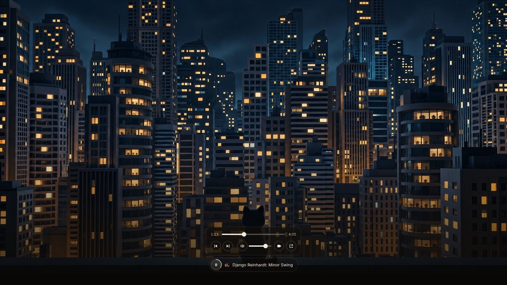

<div align="center">


# Lulu-fm

**A music discovery platform. About 67,000 songs, all from one real library: the music I've liked and the artists I follow on YouTube Music and Spotify.**

[**lulu-fm.vercel.app**](https://lulu-fm.vercel.app)

`67,000 songs` · `one player` · `no sign-up` · `no build step`

</div>

---

## What it is

Lulu is a white cat. Her day moves through six illustrated scenes, and each scene plays its own slice of a real listening library: liked songs and followed artists pulled from YouTube Music and Spotify.

Press **Enter** and the music starts. Change scene and the music changes with it. Nothing to log into, nothing to configure.

<table>
<tr>
<td width="33%"></td>
<td width="33%"></td>
<td width="33%"></td>
</tr>
<tr>
<td width="33%"></td>
<td width="33%"></td>
<td width="33%"></td>
</tr>
</table>

## Details

- **One player.** Every song, whatever service it came from, plays through a single YouTube player. Spotify only supplied the list.
- **A tiny control.** A small pill with a progress ring. Hover (or tap the chevron on a phone) for seek, skip, volume, video and an *open on YouTube* link. It fades out when idle.
- **Arrows on hover.** The scene chevrons only appear when you move toward the edges.
- **Likes surface first.** About one pick in three is a liked song, the rest is the wider catalogue.
- **Fast start.** A small starter list plays immediately and each scene's full list loads in the background when you enter it.
- **Phones.** On a portrait screen the whole frame is shown over a soft blurred copy of itself, rather than a narrow crop.
- **Sharp on a 4K monitor.** Frames ship as responsive WebP, 900 to 3840 px wide. The 4K masters are in `art/scenes/`.

Keys: `←` `→` change scene · `space` play or pause · `n` next track.

<p align="center"></p>

## How the library was built

| Source | What was taken |
|---|---|
| YouTube Music | liked songs, followed artists, and each followed artist's full songs list |
| Spotify | liked songs, playlists and followed artists |

Each artist is assigned to a scene, then every one of their songs follows. Spotify songs were matched to playable YouTube videos by artist, title and length, and low-confidence matches were dropped. About 67,000 songs in total.

## Project layout

```
docs/                 the site (Vercel serves this folder)
  index.html          one page
  site.css            all styles
  app.js              scenes, player, queue, controls
  img/                responsive WebP frames per scene
  data/lulu.json      scene metadata and the starter tracks
  data/<scene>.json   each scene's full catalogue [videoId, title, artist, liked]
  readme/             screenshots used on this page
art/scenes/           4K masters
data/ids.txt          hand-picked starter tracks (artist|title|youtubeId)
scripts/build_data.py builds docs/data/lulu.json from ids.txt
```

## Run it

No build step. Serve the `docs` folder with anything:

```bash
python3 -m http.server 8000 --directory docs
```

Then open http://localhost:8000. Edit `data/ids.txt` and run `python3 scripts/build_data.py` to change the starter list.

## Roadmap

- [ ] Refresh the library automatically from new likes and follows
- [ ] One frame regenerated at native 4K
- [ ] Lulu as a small desktop companion

---

<sub>Lulu is a real cat. The frames are illustrations. The music belongs to the artists. Every song streams from YouTube.</sub>
